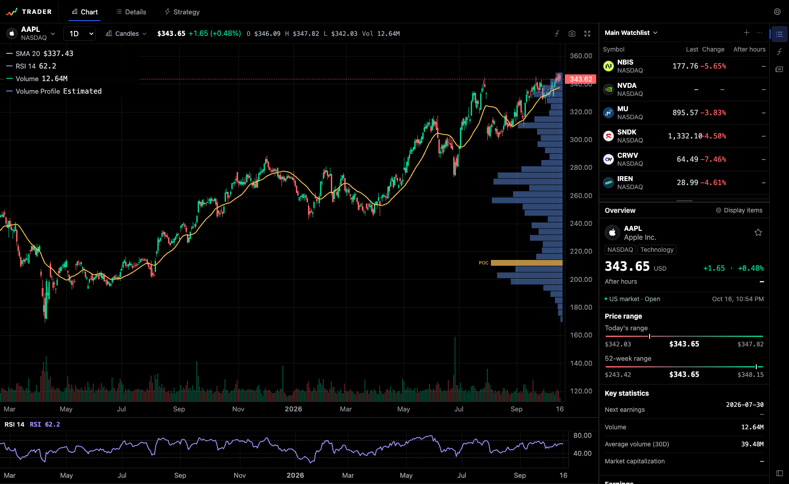
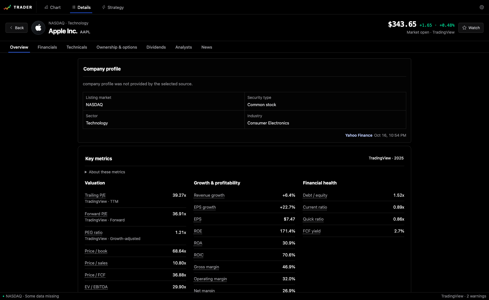

<p align="center">
  
</p>

# Trader

Trader is an open-source workspace for U.S. stock charts, company research, watchlists, technical indicators, and portable strategy packages.

> Trader is a research prototype. It does not execute brokerage orders or provide investment advice. Strategy metrics are shown only with their recorded provenance.

The screenshots below were captured from the Trader workspace on October 16, 2026. The chart and symbol-detail screens show time-sensitive, provider-derived values. The strategy screen shows recorded package backtest results and unavailable metrics where no result is recorded; these are not live trading results. No raw provider response payloads or downloaded datasets are bundled with the repository.

## Screens

### Chart workspace



_Captured with direct USD-listing quotes and bars from the market data provider websocket sidecar. Prices and timestamps reflect the observations displayed in the UI._

- candlestick, Heikin Ashi, line, and area charts with 1m–1M timeframes
- configurable 2–10,000 candle history; default 1,000
- overlay and separate-pane indicators such as SMA, EMA, Bollinger Bands, anchored VWAP, RSI, MACD, Stochastic, ATR, ADX, and OBV
- resizable right panel and independently resizable watchlist/symbol-overview split
- streaming direct-listing USD quote and change, plus the separate optional `{symbol}USDT.P` reference close

### Symbol details



_Captured from provider-derived AAPL company data. Values and observation times are shown in the interface._

- financial statements, valuation, profitability, balance sheet, cash flow, and earnings
- Google Finance callback data and Benzinga analyst ratings, with an optional firm-level merged consensus and target-price history; licensed TipRanks Enterprise remains available separately
- technical metrics calculated from the selected OHLCV series
- provider name, observation time, and missing-data states are shown explicitly

### Strategies


_The catalog UI reads checked-in strategy packages. A package without a recorded run shows unavailable metrics rather than illustrative values._

- sortable strategy table with return, drawdown, recovery factor, Sharpe ratio, audit state, and win rate
- package-backed performance and transaction snapshots with explicit provenance
- owner-scoped custom strategy CRUD, built-in name/description overrides, soft deletion, and D1-backed transaction history
- unavailable results remain null until a backtest snapshot is recorded

## Basic usage

1. Press `Command + F` or click the symbol selector to search U.S. stocks.
2. Use the timeframe dropdown beside the chart symbol selector, then choose candles, Heikin Ashi, line, or area from the adjacent chart-type menu.
3. Use **Add indicator** on the chart or the right-sidebar **Indicators** panel to add or configure studies.
4. Use `+` in the watchlist to add a symbol. Direct-listing prices and the optional `{symbol}USDT.P` reference prices stream while the tab is visible; snapshot polling takes over if either stream is unavailable. A USDT.P tick older than five minutes is cleared instead of being shown as current. Actual availability depends on market data provider access and exchange entitlements. Right-click a row to remove it.
5. Open the watchlist selector and use each list's `…` menu to rename or delete it. The final list is protected from deletion.
6. Drag the right-panel edge or the divider between the watchlist and symbol overview to resize the workspace. Both separators also support arrow keys.
7. Select **Details** in the top navigation to open financials, analysts, company research, and technicals. Financials include annual history and fiscal-period forecasts; research includes dated quarterly statements, ownership and short-interest statistics, and dividend/split history when supplied by the selected provider.
8. Open **Strategies** to inspect packaged strategies or create a custom strategy. In a strategy detail screen, use `…` to duplicate, edit, or delete it.
9. Open **Institutions**, **Ideas**, **Data sources**, or **X analysis** to browse the connected Midas research catalogs in read-only mode.
10. Use **Settings** in the workspace bar to change the candle count or switch between English and Japanese.

## Desktop app (Apple Silicon macOS)

Download the experimental Apple Silicon build from [GitHub Releases](https://github.com/ryokobachan/Trader/releases/tag/v0.1.0-preview.1). The ZIP contains `Trader.app`; this preview is ad-hoc signed and not notarized, so macOS Gatekeeper may block it.

The desktop build targets Apple Silicon Macs running macOS 14 or newer. The
installed `Trader.app` is self-contained: it bundles the application runtime
and market-data helper and uses the macOS system WebView. Opening the app starts
and stops its private loopback services automatically, so users do not need a
terminal, Bun, Python, or a separately started `localhost` server. An internet
connection is still required for live market and company data.

Building from source requires the Xcode Command Line Tools, stable Rust,
Node.js 22.13 or newer, Bun, and an Apple Silicon Python 3.12 interpreter:

```bash
npm install
npm run desktop:build
```

The finished application is written to `build/Trader.app`. Temporary native,
frontend, and sidecar build directories are removed automatically after the app
has been copied and verified.

Open the local application build with:

```bash
open build/Trader.app
```

`npm run desktop:dev` prepares the same bundled helpers and launches a debug
build. `npm run desktop:build` creates an ad-hoc signed local build whose code
signature is verifiable, but it is not Developer ID-signed or notarized. A copy
downloaded onto another Mac may therefore be blocked by Gatekeeper. A separate
Developer ID signing and notarization pipeline is required before public
distribution.

Desktop state is stored under
`~/Library/Application Support/com.ryokobachan.trader/`. The
`trader.sqlite3` database contains watchlists, strategy changes, and
transactions; `trader-desktop.log` contains startup/runtime diagnostics. Quit
Trader before copying this directory as a backup. To reset the SQLite-backed
state, quit the app and move `trader.sqlite3` plus any matching `-wal` and
`-shm` files out of the directory; the next launch creates a fresh database.
Chart and other interface preferences use WebView storage and are
not reset by replacing only the SQLite file.

## Run locally

Requirements:

- Node.js 22.13 or newer
- Python 3 for the market data provider websocket quote/chart sidecar used by the real-data profiles

Deterministic mock profile:

```bash
npm install
npm run dev -- --port 3001
```

Keyless personal-development profile:

```bash
python3 -m pip install -r api/tradingview-websocket/requirements.txt
npm run dev:yahoo
```

Open <http://localhost:3001>.

`dev:yahoo` uses the local market data provider websocket sidecar for direct USD-listing current quotes and chart bars. Yahoo-compatible endpoints provide U.S. stock search, company data, fundamentals, earnings, research, and news; the same authenticated sidecar can use pinned `yfinance` as a profile/earnings fallback when Yahoo's anonymous cookie/crumb path is unavailable. Its analyst role selects `google-finance-benzinga`, which calls both the direct Benzinga adapter and the Google Finance Analysis-page `AF_initDataCallback` parser, then OR-merges their event sets. Separately licensed TipRanks Enterprise access remains optional. These are unofficial or provider-controlled data paths. Review the applicable access, display, and redistribution terms before enabling them outside personal development.

The browser connects only to Trader's same-origin routes; it never receives the sidecar bearer token or chooses raw market data provider symbols. A hosted Sites deployment cannot reach a developer machine's loopback sidecar. Without an external sidecar it therefore keeps ordinary HTTPS requests open while the Worker waits on the same market data provider guest websocket used locally, returning each direct-USD quote or ordered `{EXCHANGE}:{symbol}USDT.P` change as completed JSON. The scanner snapshot remains a 15-second safety fallback. An optional external sidecar must use **HTTPS** and a server-side token. Transport-level streaming or polling does not itself guarantee exchange real-time entitlements.

To use market data provider financials and the independent shared data reader with Trader's own configuration:

```bash
npm run dev:tradingview
```

Secrets stay server-side. The repository contains no provider credentials or downloaded third-party datasets.

The **Data**, **Institutions** and **X analysis** screens use the same independent data catalog and API as `trader data get`. The Python helper reads `develop/.data/finance/13f` and `develop/.data/finance/x` directly without Midas or database copies. `dev:tradingview` reads Trader's own `.env.local`; the older `dev:midas` launcher name is a standalone compatibility alias. Only the excluded legacy Ideas screen retains its Midas integration. See [data access](docs/data-cli.md) for the complete catalog, HTTP/OpenAPI contract and dependency-free Python/JavaScript clients.

The standalone profile selects market data provider for financial indicators, annual/quarterly statements and dated earnings; Yahoo supplies profiles, ownership, dividends and splits. PER/PEG can be calculated from market data provider values with explicit input/basis metadata. Financial history is the currently available revision, not a complete publication-time archive. SEC financial facts and FRED publication vintages are separate inputs when historical information availability matters.

FMP has been retired: its adapter is unregistered and its credentials are excluded from environment forwarding. Company logos now use Trader's local symbol-logo route, which resolves a validated market data provider logo. To configure the same role mix in a standalone environment, use the example in [`api/README.md`](api/README.md). The website-internal APIs are not stable public API contracts: no API key is needed for the implemented market data provider financial scanner and history transport, but fields, access, and availability can change. The adapters validate response shape, listing identity, currency, and units and keep bounded transient caches.

Nasdaq current option chains and ChartExchange individual-contract history are implemented, with Yahoo as an explicit alternative for historical option OHLCV. Direct-source routes cover recent SEC filings, financial facts and Form 4 transactions, FINRA off-exchange short-sale volume, USAspending contracts, FRED and CNN Fear & Greed. Coverage is bounded by each source; a complete historical option chain and all exchange-level FINRA data are not provided. Yahoo ownership aggregates are not substitutes for filing-level data. TipRanks analyst ratings remain available only with separately licensed credentials.

## Data CLI

株価・財務・オプション・13F・X・戦略結果を同じデータIDで取得できます。`data sources` / `describe` はサーバー不要のカタログ、`data get` は稼働中の Trader API を使います。データの自動保存は行いません。

```bash
./bin/trader data sources
./bin/trader data describe options-history
./bin/trader data get options-history --symbol NBIS --contract NBIS270115C00200000 --from 2026-01-01 --to 2026-03-31
npm run --silent trader -- data get financials --symbol NBIS
```

グローバルインストールは不要です。満期切れ契約の指定、出典・対象期間・欠損の確認、終了コード、既存戦略 CLI の呼び出しは [データ CLI の使い方](docs/data-cli.md) を参照してください。

## Local MCP servers

Codex向けの読み取り専用MCPを、`mcp/`配下のMarket・13F・X Finance・Strategyの4フォルダに分けています。
MarketはTrader不要で、フォルダを別のMacへ渡して使えます。Node.js・Pythonと同梱requirements.txtのライブラリが必要です。
13F・X Finance・Strategyは、このMac内の起動済みTraderを読む専用MCPです。
配布物はすべてテキストです。Codexへの登録と初回セットアップはCodexに依頼でき、利用者自身のターミナル操作は不要です。
構成、登録手順、`get_status`の意味は[Trader MCP](docs/mcp.md)を参照してください。

## Strategy CLI and AI agents

The browser, CLI, and AI skill use the same owner-scoped API. Deployment-owned strategies are generated from validated directories under `strategies/`; owner-created strategies and their editable transactions are stored in D1. These API commands do not rewrite package source files.

```bash
npm run strategy -- list
npm run strategy -- list --family portfolio2 --provenance unavailable
npm run strategy -- list --provenance backtest_artifact --sort sharpe --order desc --limit 10
npm run strategy -- compare <strategy-id-a> <strategy-id-b> --sort netReturn
npm run strategy -- get <strategy-id> --include transactions,performance
npm run strategy -- create --file /tmp/strategy.json
npm run strategy -- edit <strategy-id> --file /tmp/strategy-edit.json --version <version>
npm run strategy -- delete <strategy-id> --version <version> --yes

npm run strategy -- transactions list <strategy-id>
npm run strategy -- transactions add <strategy-id> --file /tmp/transaction.json
npm run strategy -- transactions edit <strategy-id> <transaction-id> --file /tmp/transaction-edit.json --updated-at <updatedAt>
npm run strategy -- transactions delete <strategy-id> <transaction-id> --yes
```

Execute one checked-in package with the shared Python/VectorBT runner:

```bash
python3 -m venv venv
venv/bin/python -m pip install -r requirements-strategy.txt
npm run strategy:backtest -- portfolio-golden-cross \
  --symbols AAPL,MSFT,AMZN,GOOGL,JPM,XOM,JNJ,WMT,CAT,NEE \
  --start 2016-01-01 --end 2026-01-01 --write
```

The runner resolves the package's declared data profile, executes its target
weights with the costs and risk rules in `config.json`, then writes read-only
transaction history, performance, end positions, daily strategy/benchmark
values, and reproducibility metadata. Technical packages use adjusted Yahoo
daily data; the bundled fundamental example combines Yahoo prices/actions with
annual SEC Company Facts. Omit `--write` for a calculation-only run.

Strategy selection logic stays in Python rather than a fixed JSON rule schema.
It may rank, include, exclude, and size any of the supplied symbols and returns
one target-weight panel for the whole portfolio. Point-in-time fundamentals and
other datasets are supplied through runner-side snapshot adapters, while the
strategy output and VectorBT execution contract stay the same.

Commands emit JSON and return nonzero on API or validation errors. Custom strategy edits use optimistic versions, and transaction edits require the latest `updatedAt` token, so an agent cannot silently overwrite a newer browser change. Performance is tagged as `backtest_artifact`, `user_supplied`, `transaction_snapshot`, `unavailable`, or the legacy `illustrative_catalog`; `transaction_snapshot` currently derives only exact trade and distinct-symbol counts from persisted transactions, not returns or risk metrics.

Discovery filters and sorting run locally after one owner-scoped API read; `compare` returns the selected records, provenance groups, and an explicit `execution: "not_run"` disclosure. The `npm run strategy -- ...` API commands explore strategies already registered in Trader. They do not generate candidates, execute rules, search parameters, download market data, or run a backtest; execution is the separate `strategy:backtest` command above.

For `backtest_artifact`, the metrics and transactions come from one validated package run. Package transactions are read-only. For a custom strategy, the aggregate response's `transactions` array is the owner-scoped D1 ledger. `cash` is a percentage allocation, not a currency amount.

The repository includes [`$manage-trader-strategies`](skills/manage-trader-strategies/SKILL.md), a Codex-compatible skill that requires inspect-before-mutate, explicit confirmation for deletion, and post-mutation verification.

## Data and persistence

| Data | Default source | Storage |
|---|---|---|
| Search | Mock; Yahoo optional | Provider response only |
| Direct-listing USD current quotes | Mock; local `tradingview-websocket` optional | Provider response only |
| Company profiles and news | Disabled by default; Yahoo optional | Transient provider response only |
| Financial metrics, annual history, fiscal consensus | Disabled by default; market data provider or Yahoo optional | Transient provider response only |
| Dated EPS/revenue actuals and estimates | Disabled by default; Google Finance or Yahoo optional | Transient provider response only |
| Quarterly statements, ownership/short interest, dividends and splits | Disabled by default; Yahoo research optional | Transient provider response only |
| Chart OHLCV | Mock; local `tradingview-websocket` optional | Not stored in D1 |
| Optional `{symbol}USDT.P` reference price (local sidecar SSE or hosted Worker websocket-over-HTTPS long poll, with scanner snapshot fallback) | `tradingview-websocket` | Provider response only |
| Analyst ratings and targets | Disabled by default; Google Finance callback parsing, Benzinga, their firm-level merge, or TipRanks Enterprise optional | Transient provider response only |
| Watchlists and ordered items | User actions | D1 `DB` binding |
| Built-in strategy overrides, custom strategies, and tombstones | User actions | D1 `DB` binding |
| Packaged strategy result snapshot | Checked-in `performance.json`, `transactions.json`, optional daily `equity.json`, and successful-run `run.json` | Bundled at build time; read-only at runtime |
| Custom strategy portfolio transactions | User actions | D1 `DB` binding |
| Language, chart type, indicators, and panel sizes | User actions | Browser storage |

Persistent APIs use the Sites-provided `oai-authenticated-user-id` when present. Anonymous persistence is allowed only on a loopback local-development origin; hosted anonymous requests fail closed.

## Developer customization

For existing data and strategy customization, developers use three root folders:

- [`api/`](api/README.md) contains `config.json` and external data-source implementations. A value such as `"bars": "yahoo"` maps through the reviewed registry to `api/yahoo/`.
- [`extensions/`](extensions/README.md) contains trusted frontend module registrations. It is separate from API adapters so server credentials cannot leak into the browser bundle.
- [`strategies/`](docs/strategy-packages.md) contains only self-contained strategy directories. Shared application TypeScript stays under `src/`.

Everything that normally should not be customized is grouped under `src/`.

Use `npm run dev -- --port 3001` to test the JSON provider defaults. The
`dev:yahoo` and `dev:midas` commands are explicit real-data profiles and take
precedence over those defaults; `npm run config:check` reports the effective
selection without exposing credentials.

- array order is display order;
- remove an ID to hide that item;
- add a registered ID to show it;
- provider IDs in the JSON are build-time defaults;
- environment variables override provider defaults for each deployment;
- API keys, tokens, endpoints, formulas, and executable code never belong in this shared JSON.

Treat the whole file as public: it is bundled for the UI as well as read by the server. The runtime validator accepts only registered provider, module, tab, and metric IDs, so credentials and arbitrary URLs are rejected. Put secrets in `.env.local` or hosted secret bindings only.

The master file controls symbol-summary modules, symbol-detail tabs and scalar metric lists, strategy-detail performance cards, and default provider IDs. Earnings charts/tables remain fixed structured blocks inside the financial tab. Its schema and UI IDs are validated during startup/build; provider IDs and capabilities fail closed when the server runtime initializes. Invalid settings never silently switch to mock data.

| Change an existing item | Edit |
|---|---|
| Symbol overview content and order | `ui.symbolSummary.modules` |
| Symbol detail tabs | `ui.symbolDetail.tabs` |
| Company profile fields and order | `ui.symbolDetail.profileMetrics` |
| Financial groups and metrics | `ui.symbolDetail.fundamentalGroups` |
| Analyst, market, and technical metrics | `ui.symbolDetail.*Metrics` |
| Strategy detail performance cards | `ui.strategyDetail.summaryMetrics` |
| Search / current quote / chart / company-data API defaults | `providers.instrument`, `market`, `bars`, `profile`, `fundamentals`, `earnings`, `research`, `analyst`, `news` |

Trader keeps product Core separate from deployment-owned extensions. JSON selects from reviewed registries; adding genuinely new behavior still uses a small code entry point.

| Customize | Main entry point |
|---|---|
| Brand and logo | `src/app/platform/brand.ts`, `public/` |
| Select existing provider APIs | `api/config.json` |
| Yahoo chart/search/fundamental fields | `api/yahoo/` |
| Add a provider implementation | `api/<provider-id>/`, `api/index.server.ts`, `api/provider-roles.ts` |
| Add or edit a packaged strategy | `strategies/<strategy-id>/` |
| Package catalog generation and validation | `npm run strategies:generate`, `src/tooling/strategy-package-loader.ts` |
| Strategy performance cards | `src/app/features/strategy/metrics.ts` |
| Canonical provider DTOs | `src/app/platform/provider-contracts.ts` |
| Add a new symbol-summary module | `extensions/`, then select its ID in `api/config.json` |
| Symbol-detail metric IDs and calculations | `api/stock-detail/ids.ts`, `api/stock-detail/metrics.ts` |
| Indicator definitions and calculations | `src/app/features/chart-indicators/indicator-calculations.ts`, `src/app/features/indicators/` |
| Chart types and Heikin Ashi | `src/app/features/chart-types/` |
| Legacy chart-template storage helpers | `src/app/features/chart-templates/` |
| Resizable workspace layout | `src/app/features/workspace-layout/` |
| English/Japanese copy | `src/app/platform/i18n.tsx`, feature `*-i18n.ts` files, package `config.json` display copy |
| Transactional schema | `src/db/schema.ts`, `src/db/migrations/` |

Provider credentials remain server-side in `.env.local` or hosted secrets. Providers return canonical data with provenance instead of exposing vendor response shapes to UI components. UI modules are trusted build-time registrations; configuration cannot load arbitrary remote JavaScript.

Indicator calculations are pure TypeScript and run against the underlying canonical OHLCV series. VWAP resets at its configured session/calendar anchor, RSI uses Wilder smoothing across every surface, and ADX uses an explicit Wilder warm-up. Selecting Heikin Ashi changes candle presentation without silently replacing research inputs with synthetic OHLC. MAMA is intentionally not registered because its known implementation differences make it unsuitable as a portable built-in. The calculation registry is the single place to add and test another indicator; TA-Lib is not bundled because its native/WASM runtime would materially increase browser and Worker deployment complexity.

An API adapter cannot create a new screen by itself. Existing normalized fields
can be selected entirely from `api/config.json`, while a new domain such as an
options chain needs both `api/<provider>/` for data and `extensions/<feature>/`
for presentation. The current extension host supports the symbol summary;
brand-new detail tabs still require one reviewed Core connection. See
[`extensions/README.md`](extensions/README.md) for the exact boundary.

Technical contracts:

- [Data providers](docs/contracts/data-providers.md)
- [Indicator registry](docs/contracts/indicator-registry.md)
- [UI module registry](docs/contracts/ui-module-registry.md)
- [Watchlists](docs/contracts/watchlists.md)
- [Unified strategies](docs/contracts/strategies.md)
- [Strategy preferences](docs/contracts/strategy-preferences.md)
- [Strategy transactions](docs/contracts/strategy-portfolio-transactions.md)
- [Storage boundaries](docs/architecture/data-storage.md)

## Project structure

```text
api/                 public config and external data-provider adapters
extensions/          trusted developer-installed frontend modules
strategies/          portable strategy directories and their latest result snapshots
src/app/             UI, internal HTTP routes, and Core contracts
src/db/              D1 schema, migrations, and Drizzle configuration
src/desktop/         desktop frontend, runtime, native shell, icons, and build config
src/worker/          Cloudflare/Vinext worker entry
src/tooling/         build-only internal tooling
public/              brand artwork and README screenshots
tests/               contract, security-boundary, SSR, and UI-structure tests
```

Cloudflare D1/R2 binding names are configured in `src/worker/cloudflare.config.json`.
The build generates Sites deployment metadata under ignored `dist/.openai/`
from this configuration and the checked-in database migrations. No root
`.openai/` folder is required.

`.vinext/`, `.wrangler/`, `var/`, `dist/`, `build/`,
`src/desktop/frontend-dist/`, `src/desktop/tauri/target/`, `node_modules/`,
and `tsconfig.tsbuildinfo` are ignored
local outputs, not repository source.
Local D1 state lives under ignored `var/cloudflare/`; deleting it resets local
watchlists, strategy preferences, and transactions without deleting the schema.
Mutable runtime data never belongs under `src/`, where it could be bundled or
committed. Browser automation records (`.playwright-cli/`, `output/`) and local
review artifacts (`artifacts/`) are also ignored; research sources and data are
not covered by these exclusions.

## Quality checks

```bash
npm run lint
npm run config:check
npm test
npx tsc --noEmit
npm audit --omit=dev
```

The production dependency audit is expected to report zero known vulnerabilities. Some local build-tool advisories may remain upstream; they are not included in the deployed runtime and are tracked separately from production dependencies.

## License

Apache License 2.0. See [LICENSE](LICENSE).

Company names, logos, TradingView, Yahoo, Google Finance, Benzinga, and Midas remain the property of their respective owners. Their mention does not imply affiliation or endorsement.
