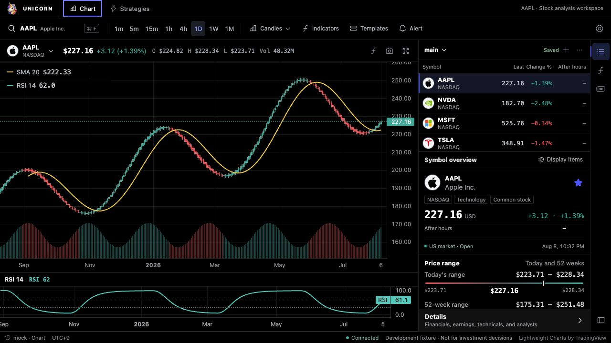
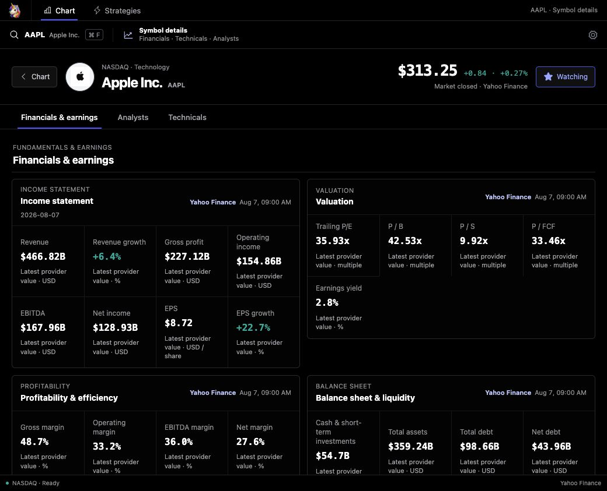
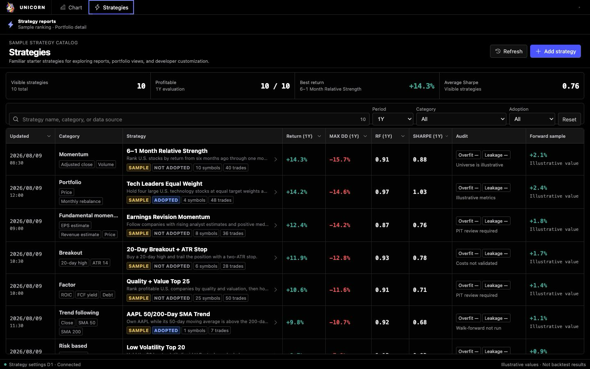

<p align="center">
  
</p>

# Unicorn

Unicorn is an open-source, TradingView-inspired workspace for U.S. stock charts, company research, watchlists, technical indicators, and sample strategy portfolios.

> Unicorn is a research prototype. It does not execute orders or provide investment advice. Strategy metrics are illustrative unless a backtest provider is connected.

The chart and symbol-detail screenshots below were captured with Unicorn's optional real-data profile and show time-sensitive, provider-derived values. The strategy screenshot uses Unicorn's deterministic sample catalog. No raw provider response payloads or downloaded datasets are bundled with the repository.

## Screens

### Chart workspace



_Captured with direct USD-listing quotes and bars from the TradingView websocket sidecar. Prices and timestamps reflect the observations displayed in the UI._

- candlestick, Heikin Ashi, line, and area charts with 1m–1M timeframes
- configurable 2–10,000 candle history; default 1,000
- overlay and separate-pane indicators such as SMA, EMA, Bollinger Bands, anchored VWAP, RSI, MACD, Stochastic, ATR, ADX, and OBV
- saved chart templates that can be created, renamed, applied, and deleted
- resizable right panel and independently resizable watchlist/symbol-overview split
- streaming direct-listing USD quote and change, plus the separate optional `{symbol}USDT.P` reference close

### Symbol details



_Captured from provider-derived AAPL company data. Values and observation times are shown in the interface._

- financial statements, valuation, profitability, balance sheet, cash flow, and earnings
- Benzinga-compatible analyst ratings and target-price history
- technical metrics calculated from the selected OHLCV series
- provider name, observation time, and missing-data states are shown explicitly

### Strategies



_The built-in strategy catalog is deterministic sample data, not a verified backtest result._

- sortable sample strategy table with return, drawdown, recovery factor, Sharpe ratio, audit state, and win rate
- portfolio overview, holdings, transactions, profitability, and symbol contribution
- owner-scoped custom strategy CRUD, built-in name/description overrides, soft deletion, and D1-backed transaction history
- sample values are intentionally conservative examples, not verified backtest results

## Basic usage

1. Press `Command + F` or click the symbol selector to search U.S. stocks.
2. Select a timeframe and choose candles, Heikin Ashi, line, or area, then use **Indicators** to add or configure studies.
3. Use **Templates** to apply a built-in setup or save, rename, and delete your own indicator setup.
4. Use `+` in the watchlist to add a symbol. Direct-listing prices and the optional `{symbol}USDT.P` reference prices stream while the tab is visible; snapshot polling takes over if either stream is unavailable. Actual freshness depends on TradingView access and exchange entitlements. Right-click a row to remove it.
5. Open the watchlist selector and use each list's `…` menu to rename or delete it. The final list is protected from deletion.
6. Drag the right-panel edge or the divider between the watchlist and symbol overview to resize the workspace. Both separators also support arrow keys.
7. Select **Details** in the symbol overview to open financials, analysts, and technicals.
8. Open **Strategies** to inspect samples or create a custom strategy. In a strategy detail screen, use `…` to duplicate, edit, or delete it.
9. Use **Settings** in the top bar to change the candle count or switch between English and Japanese.

## Run locally

Requirements:

- Node.js 22.13 or newer
- Python 3 for the TradingView websocket quote/chart sidecar used by the real-data profiles

Deterministic mock profile:

```bash
npm install
npm run dev -- --port 3001
```

Keyless personal-development profile:

```bash
python3 -m pip install -r api/tradingview-websocket/requirements.txt
npm run dev:yahoo
```

Open <http://localhost:3001>.

`dev:yahoo` uses the local TradingView websocket sidecar for direct USD-listing current quotes and chart bars. Yahoo-compatible endpoints provide U.S. stock search, company data, fundamentals, earnings, and news; the same authenticated sidecar can use pinned `yfinance` as a profile/earnings fallback when Yahoo's anonymous cookie/crumb path is unavailable. The Midas-compatible Benzinga adapter supplies analyst ratings. These are unofficial or provider-controlled data paths. Review the applicable access, display, and redistribution terms before enabling them outside personal development.

The browser connects only to Unicorn's same-origin SSE route; it never receives the sidecar bearer token. A hosted Sites deployment cannot reach a developer machine's loopback sidecar. Configure an externally reachable **HTTPS** sidecar URL and a server-side token for hosted use. Transport-level streaming does not itself guarantee exchange real-time entitlements.

To reuse only the allow-listed FMP/Benzinga values from a local Midas environment file:

```bash
MIDAS_ENV_FILE=/absolute/path/to/Midas/.env npm run dev:midas
```

Secrets stay server-side. The repository contains no provider credentials or downloaded third-party datasets.

`dev:midas` is a credential/profile bridge, not a connection to the Midas database or `/data-sources` API. It reuses only allow-listed FMP/Benzinga settings and still calls the configured upstream providers directly. In this profile, FMP supplies company profiles, fundamentals, and earnings; this includes float/share structure and FMP-calculated Altman Z and Piotroski scores. Unicorn currently normalizes prices, company/fundamental/earnings data, analyst ratings, and news. Options, SEC ownership and insider filings, FINRA short data, corporate actions, government awards, and source scores still require dedicated provider contracts and UI extensions. TipRanks and Investing.com event feeds are intentionally out of scope.

## Strategy CLI and AI agents

The browser, CLI, and AI skill use the same owner-scoped API. Runtime strategy changes and transactions are stored in D1; none of these commands edit the built-in source catalog.

```bash
npm run strategy -- list
npm run strategy -- list --family rule --provenance illustrative_catalog --sort sharpe --order desc --limit 10
npm run strategy -- compare <strategy-id-a> <strategy-id-b> --sort netReturn
npm run strategy -- get <strategy-id> --include transactions,performance
npm run strategy -- create --file /tmp/strategy.json
npm run strategy -- edit <strategy-id> --file /tmp/strategy-edit.json --version <version>
npm run strategy -- delete <strategy-id> --version <version> --yes

npm run strategy -- transactions list <strategy-id>
npm run strategy -- transactions add <strategy-id> --file /tmp/transaction.json
npm run strategy -- transactions edit <strategy-id> <transaction-id> --file /tmp/transaction-edit.json --updated-at <updatedAt>
npm run strategy -- transactions delete <strategy-id> <transaction-id> --yes
```

Commands emit JSON and return nonzero on API or validation errors. Custom strategy edits use optimistic versions, and transaction edits require the latest `updatedAt` token, so an agent cannot silently overwrite a newer browser change. Performance is tagged as `illustrative_catalog`, `user_supplied`, `transaction_snapshot`, or `unavailable`; `transaction_snapshot` currently derives only exact trade and distinct-symbol counts from persisted transactions, not returns or risk metrics.

Discovery filters and sorting run locally after one owner-scoped API read; `compare` returns the selected records, provenance groups, and an explicit `execution: "not_run"` disclosure. These commands explore strategies already registered in Unicorn. They do not generate candidates, execute rules, search parameters, download market data, or run a backtest.

For an `illustrative_catalog` record, the `trades` and `symbols` fields are sample metadata, not saved D1 row counts. The aggregate response's `transactions` array is the durable trade history, and `cash` is a percentage allocation.

The repository includes [`$manage-unicorn-strategies`](skills/manage-unicorn-strategies/SKILL.md), a Codex-compatible skill that requires inspect-before-mutate, explicit confirmation for deletion, and post-mutation verification.

## Data and persistence

| Data | Default source | Storage |
|---|---|---|
| Search | Mock; Yahoo/FMP optional | Provider response only |
| Direct-listing USD current quotes | Mock; local `tradingview-websocket` optional | Provider response only |
| Company profile, fundamentals, earnings, news | Disabled by default; Yahoo/FMP optional | Provider response only |
| Chart OHLCV | Mock; local `tradingview-websocket` optional | Not stored in D1 |
| Optional `{symbol}USDT.P` reference price (SSE with snapshot fallback) | Local `tradingview-websocket` | Provider response only |
| Analyst ratings and targets | Disabled by default; Benzinga-compatible adapter optional | Provider response only |
| Watchlists and ordered items | User actions | D1 `DB` binding |
| Built-in strategy overrides, custom strategies, and tombstones | User actions | D1 `DB` binding |
| Strategy portfolio transactions | User actions | D1 `DB` binding |
| Language, chart type, indicators, templates, and panel sizes | User actions | Browser storage |

Persistent APIs use the Sites-provided `oai-authenticated-user-id` when present. Anonymous persistence is allowed only on a loopback local-development origin; hosted anonymous requests fail closed.

## Developer customization

For existing data and strategy customization, developers use three root folders:

- [`api/`](api/README.md) contains `config.json` and external data-source implementations. A value such as `"bars": "yahoo"` maps through the reviewed registry to `api/yahoo/`.
- [`extensions/`](extensions/README.md) contains trusted frontend module registrations. It is separate from API adapters so server credentials cannot leak into the browser bundle.
- [`strategies/`](strategies/README.md) contains the built-in strategy catalog, performance-card definitions, sample holdings, and an explicit demo transaction fixture.

Everything that normally should not be customized is grouped under `src/`.

Use `npm run dev -- --port 3001` to test the JSON provider defaults. The
`dev:yahoo` and `dev:midas` commands are explicit real-data profiles and take
precedence over those defaults; `npm run config:check` reports the effective
selection without exposing credentials.

- array order is display order;
- remove an ID to hide that item;
- add a registered ID to show it;
- provider IDs in the JSON are build-time defaults;
- environment variables override provider defaults for each deployment;
- API keys, tokens, endpoints, formulas, and executable code never belong in this shared JSON.

Treat the whole file as public: it is bundled for the UI as well as read by the server. The runtime validator accepts only registered provider, module, tab, and metric IDs, so credentials and arbitrary URLs are rejected. Put secrets in `.env.local` or hosted secret bindings only.

The master file controls symbol-summary modules, symbol-detail tabs and scalar metric lists, strategy-detail performance cards, and default provider IDs. Earnings charts/tables remain fixed structured blocks inside the financial tab. Its schema and UI IDs are validated during startup/build; provider IDs and capabilities fail closed when the server runtime initializes. Invalid settings never silently switch to mock data.

| Change an existing item | Edit |
|---|---|
| Symbol overview content and order | `ui.symbolSummary.modules` |
| Symbol detail tabs | `ui.symbolDetail.tabs` |
| Company profile fields and order | `ui.symbolDetail.profileMetrics` |
| Financial groups and metrics | `ui.symbolDetail.fundamentalGroups` |
| Analyst, market, and technical metrics | `ui.symbolDetail.*Metrics` |
| Strategy detail performance cards | `ui.strategyDetail.summaryMetrics` |
| Search / current quote / chart / company-data API defaults | `providers.instrument`, `market`, `bars`, `profile`, `fundamentals`, `earnings`, `analyst`, `news` |

Unicorn keeps product Core separate from deployment-owned extensions. JSON selects from reviewed registries; adding genuinely new behavior still uses a small code entry point.

| Customize | Main entry point |
|---|---|
| Brand and logo | `src/app/platform/brand.ts`, `public/` |
| Select existing provider APIs | `api/config.json` |
| Yahoo chart/search/fundamental fields | `api/yahoo/` |
| Add a provider implementation | `api/<provider-id>/`, `api/index.server.ts`, `api/provider-roles.ts` |
| Sample strategy definitions | `strategies/catalog.ts` |
| Strategy performance cards | `strategies/metrics.ts` |
| Sample holdings / optional demo transactions | `strategies/sample-portfolio.ts`, `strategies/sample-transactions.ts` |
| Canonical provider DTOs | `src/app/platform/provider-contracts.ts` |
| Add a new symbol-summary module | `extensions/`, then select its ID in `api/config.json` |
| Symbol-detail metric IDs and calculations | `api/stock-detail/ids.ts`, `api/stock-detail/metrics.ts` |
| Indicator definitions and calculations | `src/app/features/chart-indicators/indicator-calculations.ts`, `src/app/features/indicators/` |
| Chart types and Heikin Ashi | `src/app/features/chart-types/` |
| Saved chart templates | `src/app/features/chart-templates/` |
| Resizable workspace layout | `src/app/features/workspace-layout/` |
| English/Japanese copy | `src/app/platform/i18n.tsx`, feature `*-i18n.ts` files, `strategies/i18n.ts` |
| Transactional schema | `src/db/schema.ts`, `src/db/migrations/` |

Provider credentials remain server-side in `.env.local` or hosted secrets. Providers return canonical data with provenance instead of exposing vendor response shapes to UI components. UI modules are trusted build-time registrations; configuration cannot load arbitrary remote JavaScript.

Indicator calculations are pure TypeScript and run against the underlying canonical OHLCV series. VWAP resets at its configured session/calendar anchor, RSI uses Wilder smoothing across every surface, and ADX uses an explicit Wilder warm-up. Selecting Heikin Ashi changes candle presentation without silently replacing research inputs with synthetic OHLC. MAMA is intentionally not registered because its known implementation differences make it unsuitable as a portable built-in. The calculation registry is the single place to add and test another indicator; TA-Lib is not bundled because its native/WASM runtime would materially increase browser and Worker deployment complexity.

An API adapter cannot create a new screen by itself. Existing normalized fields
can be selected entirely from `api/config.json`, while a new domain such as an
options chain needs both `api/<provider>/` for data and `extensions/<feature>/`
for presentation. The current extension host supports the symbol summary;
brand-new detail tabs still require one reviewed Core connection. See
[`extensions/README.md`](extensions/README.md) for the exact boundary.

Technical contracts:

- [Data providers](docs/contracts/data-providers.md)
- [Indicator registry](docs/contracts/indicator-registry.md)
- [UI module registry](docs/contracts/ui-module-registry.md)
- [Watchlists](docs/contracts/watchlists.md)
- [Unified strategies](docs/contracts/strategies.md)
- [Strategy preferences](docs/contracts/strategy-preferences.md)
- [Strategy transactions](docs/contracts/strategy-portfolio-transactions.md)
- [Storage boundaries](docs/architecture/data-storage.md)

## Project structure

```text
api/                 public config and external data-provider adapters
extensions/          trusted developer-installed frontend modules
strategies/          sample strategy definitions, metrics, holdings, seed trades
src/app/             UI, internal HTTP routes, and Core contracts
src/db/              D1 schema, migrations, and Drizzle configuration
src/worker/          Cloudflare/Vinext worker entry
src/tooling/         build-only internal tooling
public/              brand artwork and README screenshots
tests/               contract, security-boundary, SSR, and UI-structure tests
```

One small service-owned root folder stays in its conventional location:

| Folder | Why it stays |
|---|---|
| `.openai/` | Sites hosting and the D1 `DB` binding |

`.vinext/`, `.wrangler/`, `var/`, `dist/`, `node_modules/`, and
`tsconfig.tsbuildinfo` are ignored local outputs, not repository source.
Local D1 state lives under ignored `var/cloudflare/`; deleting it resets local
watchlists, strategy preferences, and transactions without deleting the schema.
Mutable runtime data never belongs under `src/`, where it could be bundled or
committed. `.openai/hosting.json` remains at the root because Sites discovers
the hosted D1 binding there.

## Quality checks

```bash
npm run lint
npm run config:check
npm test
npx tsc --noEmit
npm audit --omit=dev
```

The production dependency audit is expected to report zero known vulnerabilities. Some local build-tool advisories may remain upstream; they are not included in the deployed runtime and are tracked separately from production dependencies.

## License

Apache License 2.0. See [LICENSE](LICENSE).

Company names, logos, TradingView, Yahoo, Benzinga, FMP, and Midas remain the property of their respective owners. Their mention does not imply affiliation or endorsement.
