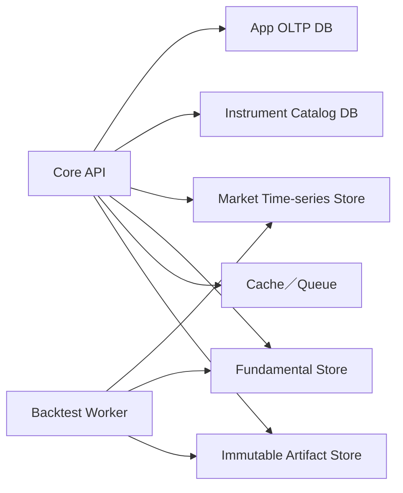

# Data Storage Boundaries

- Version: 1.0-draft
- Status: D1 application storage implemented; catalog, analytical stores, cache, and backtest artifacts proposed
- Goal: keep transactional application data separate from market, fundamental, cache, and run artifacts
- Project overview: [README](../../README.md)

## 1. Current implementation

The current application persists watchlists, built-in strategy presentation
overrides, owner-scoped custom strategies, soft-delete tombstones, audit events,
and strategy portfolio transactions in the Cloudflare D1 `DB` binding. Browser
display preferences remain in local storage. Provider responses, chart bars,
fundamentals, and backtest artifacts are not persisted by Trader.

The remaining stores below are a future reference architecture. Their URI names
are intentionally not present in `.env.example` until corresponding adapters
exist.

## 2. Proposed physical boundaries



No chart OHLCV, SEC raw payload, or equity-curve blob is stored in the App OLTP database.

## 3. Proposed store responsibilities

### App OLTP DB — `APP_DATABASE_URL`

Transactional, user-owned state:

- users, workspaces, roles
- watchlists and ordered watchlist items
- display config and indicator presets
- strategy registry metadata, versions, status, tags, blockers
- portfolio and transaction records
- backtest job metadata and artifact references
- provider preference and opaque credential references
- audit events

Requirements:

- ACID transaction for each user action
- schema migrations, row-level workspace authorization, optimistic version column
- regular backup and point-in-time recovery in production
- values large enough to require object storage are stored by URI and hash only

### Instrument Catalog DB — `CATALOG_DATABASE_URL`

Provider-synchronized reference data:

- canonical instruments and symbol history
- provider IDs, exchange, currency, active／delisted status
- search tokens and ranking metadata
- logo metadata, not unrestricted image binaries
- sync cursor, source timestamp, provenance hash

It is rebuildable from source and backups. Watchlists reference stable `instrument_id`; because there is no cross-database foreign key, Core validates the ID through Catalog service before committing an App DB row.

### Market store — `MARKET_DATA_URI`

Immutable or append-only OHLCV／quote／corporate-action partitions. Local MVP uses Parquet; a production adapter may use object storage plus DuckDB, ClickHouse, or Timescale-compatible storage.

Suggested Parquet layout:

```text
market/
  provider=massive/
    dataset=bars/
      adjustment=split_adjusted/
        interval=1d/
          instrument_id=us_xnas_aapl/
            year=2026/part-....parquet
    dataset=corporate_actions/
      event_type=split/year=2026/part-....parquet
```

Partition metadata records provider version, entitlement, source range, ingestion time, schema version, row count, and content hash. Corrections create a new partition version; canonical views choose the effective version without rewriting provenance.

### Fundamental store — `FUNDAMENTALS_DATA_URI`

```text
fundamentals/
  provider=sec_edgar/
    raw/cik=0000320193/accession=.../payload.json.zst
    facts/cik=0000320193/year=2026/part-....parquet
  provider=fmp/
    normalized/instrument_id=us_xnas_aapl/year=2026/part-....parquet
```

Raw provider payload and normalized facts remain distinct and linked by hash. Amendments do not overwrite the original filing.

### Artifact store — `BACKTEST_ARTIFACTS_URI`／`PROVIDER_RAW_DATA_URI`

- Midas Manifest, TargetPlan, price snapshot references
- run manifest, normalized／raw result, equity, returns, orders, trades
- Provider raw payloads retained according to license and retention policy
- immutable content-addressed artifacts with workspace authorization

### Cache／Queue — `CACHE_URL`／`JOB_QUEUE_URL`

- response cache, provider quota state, job messages, short-lived locks
- never the system of record
- safe to flush; loss may delay jobs but cannot lose committed watchlists or strategies

## 4. Proposed local directory layout

```text
var/
  app/trader.sqlite
  catalog/instruments.sqlite
  market/
  fundamentals/
  artifacts/
    providers/
    backtests/
  cache/
```

`var/` is runtime data and must be gitignored. Test fixtures live separately under `fixtures/` and contain synthetic, redistributable data only.

The checked-in Drizzle migrations are the current deployment source of truth;
local previews also initialize the same D1 tables idempotently so a fresh
checkout is usable.

The MVP owner adapter uses the stable Sites `oai-authenticated-user-id` for
hosted requests and permits the single `local-workspace` fallback only for an
anonymous loopback request. Every table and query is owner-scoped. Market bars,
fundamentals, provider payloads, and strategy result artifacts are not written to D1.
R2 remains disabled until an artifact workflow is implemented.

## 5. Transaction workflow examples

### Add to watchlist

1. Resolve symbol through Catalog and obtain stable `instrument_id`.
2. Begin App DB transaction.
3. Insert watchlist item with uniqueness and ordering constraints.
4. Append audit event in the same transaction.
5. Commit; market data is fetched independently and may fail without rolling back the watchlist.

### Register strategy

1. Validate definition／Midas manifest and write immutable content-addressed artifact.
2. Begin App DB transaction.
3. Insert strategy version metadata with artifact URI and hash.
4. Append audit event and commit.
5. A chart-data outage does not corrupt or delete the strategy record.

### Add a strategy portfolio transaction

1. Validate the owner-scoped strategy ID and canonical transaction DTO.
2. Insert the transaction and its audit event in one D1 batch.
3. Use `(owner_id, strategy_id, transaction_id)` as the idempotency boundary.
4. Read market prices independently; a Provider outage does not roll back the committed transaction.

### Edit or remove a built-in sample strategy

1. Validate the ID against the immutable deployment-owned sample catalog.
2. Upsert only the owner's name/headline override, or write a `deleted_at` tombstone.
3. Append a `strategy_preference` audit event; do not modify portfolio transactions.
4. Reject deletion when it would leave the owner with no visible strategy.

### Run backtest

1. App DB creates queued Run metadata and idempotency key.
2. Worker reads immutable market／fundamental snapshots.
3. Worker writes result artifacts.
4. App DB transaction changes run status and records artifact URI／hash.
5. Partial artifacts from failed runs are quarantined and never published as completed.

## 6. Backup, retention, and deletion

| Store | Backup／retention |
|---|---|
| App DB | Daily backup; production PITR; restore drill; user deletion workflow |
| Catalog | Daily snapshot; rebuildable from provider; keep symbol-history lineage |
| Market | Versioned partitions; retain per provider license; regenerate cache indexes |
| Fundamentals | Preserve original/amendment lineage within license policy |
| Backtest artifacts | Immutable while referenced; configurable workspace retention |
| Cache／queue | No backup requirement |

Workspace deletion removes or cryptographically expires user-owned transaction data and private artifacts. Shared market data is reference-counted／policy-managed and is not deleted merely because one workspace is removed.

## 7. Customizable versus Core-owned

Developer-customizable:

- App DB driver, Catalog driver, object-store and analytical-store adapters
- local filesystem versus S3／R2-compatible URIs
- cache／queue backend
- retention policy within provider license constraints

Core-owned and invariant:

- logical separation of OLTP, Catalog, market, fundamentals, artifacts, cache
- stable Instrument ID and content hashes
- immutable run artifacts and provenance
- transaction／audit semantics
- tenant authorization and secret separation
- no binary time-series blobs in App DB

An adapter must pass storage conformance tests before it can be registered.

## 8. Storage conformance tests

- App action remains committed when market Provider is unavailable
- market／fundamental correction does not mutate prior content hashes
- cross-workspace artifact access is denied
- retrying an idempotent strategy registration does not create duplicate versions
- backup restore preserves watchlist order and strategy artifact references
- cache flush does not lose committed state
- local filesystem paths cannot escape configured roots
- license retention removes restricted raw data without orphaning audit metadata
