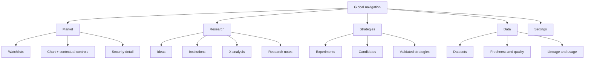
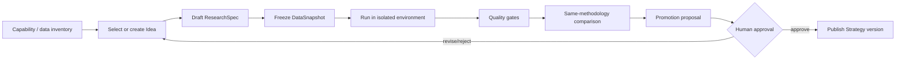

# Trader Research OS 提案

- ステータス: 提案
- 対象: Trader の情報設計、戦略探索、データソース管理
- 現在の実装（2026-09-07）: 13F・Xは独立producerの `develop/.data` を直接読み、CLI・HTTP・画面を共通カタログで提供。以下は当初提案であり、現状の取得仕様は [data-cli.md](data-cli.md) を優先する。

## 1. 結論

Trader は「チャート画面に研究機能を足したアプリ」ではなく、次の 4 領域を持つ Research OS として整理する。

1. **Market** — 銘柄、ウォッチリスト、チャート、企業情報
2. **Research** — アイデア、機関投資家、X 分析、調査ノート
3. **Strategies** — 実験、候補、検証済み戦略、ポートフォリオ
4. **Data** — データセット、取得状況、品質、来歴、利用先

最上段はこのグローバルナビゲーションに固定し、銘柄、時間足、チャート種別などは **Market のチャートだけに属するコンテキスト操作**として、その下に置く。研究画面や戦略画面には銘柄・時間足を常設しない。

研究の標準ライフサイクルは `Idea -> Experiment -> Strategy` とする。AI エージェントはデータと能力の棚卸し、仕様作成、実験、比較、昇格提案まで行えるが、公開戦略への昇格と破壊的な変更には人間の承認を必須とする。

データについては、物理ストレージを無理に一つへ統合しない。既存の provider registry、Midas の研究カタログ、戦略 runner の Yahoo/SEC snapshot を、安定した dataset ID と共通メタデータで関連付ける **Data Hub** を Trader に置く。

## 2. 現状と解くべき問題

### 2.1 画面構造

- 銘柄・時間足などのチャート専用操作が、Strategies、機関投資家、Ideas、Data、X 分析といったアプリ全体の移動より上にあると、情報の階層が逆転する。
- Midas 由来の 4 画面は閲覧できても、一覧から詳細へ進む、詳細から関連銘柄や戦略へ移る、元の位置へ戻る、という研究フローが連続していない。
- 選択状態が URL に十分表現されない場合、再読み込み、共有、ブラウザの戻る操作、AI エージェントによる同一画面の再現が難しくなる。

### 2.2 研究から戦略までの断絶

- `strategies/` には現在 3 つのパッケージがあり、Golden Cross と Fundamental Quality/Value は `run.json`、`performance.json`、`transactions.json`、`equity.json` を持つ。一方、LightGBM Ranking は未実行状態を表現している。
- `research/technical-overnight-study/` には凍結データ、コードハッシュ、候補選定、holdout、robustness を含む再現可能な研究があるが、登録戦略ではない。これは「Experiment」の具体例に近い。
- Midas の Ideas、研究ディレクトリ、登録戦略の間に安定した参照がなく、「どのアイデアを、どのデータで、どの実験が検証し、どの戦略へ昇格したか」を一続きに追えない。
- 戦略 API/CLI は一覧、比較、詳細、作成、編集、削除、取引管理を提供するが、仮説登録、実験実行、品質ゲート、昇格提案は独立した契約になっていない。

### 2.3 データ管理の分断

現在は少なくとも次の 3 つのデータ平面がある。

| データ平面 | 現在の役割 | 強み | 不足している接続 |
|---|---|---|---|
| Trader provider registry | quote、bars、fundamentals、analyst、news などの実行時 capability | canonical DTO、credential 分離、fail-closed | 取得履歴、snapshot、研究利用先 |
| Midas research catalog | 機関投資家、Ideas、Data Sources、X 分析 | 研究コンテキストと producer 側の状態 | Trader の戦略・run への安定参照 |
| strategy runner snapshots | Yahoo 日足、SEC Company Facts、run/data hash | point-in-time と再現性 | 横断検索、freshness、lineage 表示 |

データを一つの DB にコピーするだけでは、二重書き込み、更新競合、ライセンス違反、時点整合性の欠落が生じる。必要なのは物理統合より先に、メタデータと利用履歴の統合である。

### 2.4 AI エージェント利用の安全性

- 現在の strategy CLI は検索・比較・dry な確認に向く一方、ローカル runner は「信頼済み Python コード」を OS ユーザー権限で実行する。プロセス分離はされるが、ファイル、ネットワーク、資源の sandbox ではない。
- エージェントに任意コードの生成と実行、戦略登録、データ更新を一括で許すと、再現不能な結果、methodology の異なる比較、資格情報流出、意図しない上書きが起き得る。

## 3. 推奨する情報設計



### 3.1 グローバルナビゲーション

| 領域 | 主な問い | 常設する操作 |
|---|---|---|
| Market | 今、銘柄と市場で何が起きているか | 銘柄検索、ウォッチリスト、チャート |
| Research | 何を調べるべきか、根拠は何か | 検索、絞り込み、保存、関連付け |
| Strategies | 仮説は検証に耐え、運用候補になるか | 比較、実験、昇格提案、ポートフォリオ |
| Data | その判断に使ったデータは信頼できるか | freshness、coverage、lineage、利用先 |
| Settings | 環境・権限・表示をどう設定するか | provider 選択、資格情報参照、権限 |

チャートの銘柄、時間足、種別、インジケーター、テンプレートは Market のローカル操作であり、グローバルナビゲーションの下にだけ表示する。研究や戦略の詳細から銘柄を開くときは Market へ遷移し、選択銘柄を URL に含める。

### 3.2 一覧と詳細

Research と Data は desktop では master/detail、狭い画面では list -> detail の画面遷移を基本とする。行全体を曖昧にクリック可能にするのではなく、名前を実リンクまたはボタンにし、フォーカス、Enter/Space、戻る操作を保証する。

推奨 URL 例:

```text
/market/:instrumentId
/research/ideas/:ideaId
/research/institutions/:institutionId
/research/x/:authorHandle
/strategies/experiments/:experimentId
/strategies/:strategyId
/data/:datasetId
```

当面 single-page state で実装する場合も、最終的にはこの URL を状態の source of truth にする。共有リンクは選択中の詳細、フィルター、比較対象を復元できるようにする。

### 3.3 横断リンク

各詳細画面は「関連先」を第一級の情報として扱う。

- X アカウント -> 言及銘柄、関連 Idea、根拠に使った X dataset snapshot
- 機関投資家 -> 保有銘柄、提出時点、13F dataset snapshot、派生 Idea
- Idea -> 必要データ、関連研究、Experiment、昇格済み Strategy
- Experiment -> ResearchSpec、DataSnapshot、RunArtifact、比較対象、判定
- Strategy -> 元 Idea/Experiment、最新 validated run、ポートフォリオ、使用 dataset
- Dataset -> producer、snapshot、品質、lineage、使用中の Experiment/Strategy

## 4. `Idea -> Experiment -> Strategy` の標準モデル

### 4.1 Idea

Idea は「面白そうな説明文」ではなく、検証可能な仮説の入口とする。

必須項目:

- `ideaId`、名前、要約、作成者、作成日時
- 仮説、対象 universe、想定 horizon
- 必要な dataset capability
- 成功指標と棄却条件
- 既知のバイアス、リーケージ懸念
- 根拠リンク（X、機関投資家、論文、調査ノート）
- 状態: `draft | ready_for_experiment | testing | accepted | rejected | archived`

Idea 自体には backtest 指標を持たせない。数値は Experiment/Run に属させる。

### 4.2 Experiment

Experiment は凍結された仕様とデータで行う、一つ以上の再現可能な run のまとまりである。`research/technical-overnight-study/` のように、calibration、validation、holdout、候補ゲート、制約と限界を明示できる単位を目標にする。

提案契約:

- `trader.research-spec.v1` — 何を、どの条件で検証するか
- `trader.research-run.v1` — どのコード、snapshot、runtime で何が起きたか

ResearchSpec の主要項目:

```json
{
  "schemaVersion": "trader.research-spec.v1",
  "experimentId": "exp_...",
  "ideaId": "idea_...",
  "hypothesis": "...",
  "universe": { "definition": "...", "asOf": "..." },
  "datasets": [{ "datasetId": "...", "snapshotId": "..." }],
  "methodology": {
    "signal": "...",
    "execution": "...",
    "feesBps": 10,
    "splits": ["calibration", "validation", "holdout"]
  },
  "acceptanceGates": ["..."],
  "knownLimitations": ["..."]
}
```

ResearchRun の主要項目:

- immutable `runId` と ResearchSpec hash
- dataset snapshot ID/hash、code hash、runtime hash、parameters
- 開始・終了、状態、失敗理由、ログ参照
- performance、benchmark、trades、equity、診断 artifact の URI/hash
- look-ahead、survivorship、selection、multiple-testing、PIT の監査結果
- 再現コマンドまたは runner profile

仕様変更は既存 Experiment の上書きではなく新 version にする。結果のよかった parameter だけを後から仕様に書き戻さない。

### 4.3 Strategy

Strategy は「採用可能な実装と検証済み artifact の組」である。既存の `trader.strategies.v1` と `strategies/<strategy-id>/` を継続利用し、次の参照を追加する。

- `sourceIdeaIds`
- `sourceExperimentIds`
- `validatedRunId`
- `methodologyCohortId`
- `promotionDecision` と承認者・日時

昇格条件:

1. acceptance gate をすべて通過する。
2. `run.json` 相当のデータ、コード、runtime、設定 hash が揃う。
3. performance と equity/transactions が照合できる。
4. 比較対象が同じ universe、期間、費用、benchmark、評価方法を使う。
5. 既知の限界と運用上の blocker が表示される。
6. 人間が昇格を承認する。

Sharpe や return が高いだけでは昇格しない。methodology が違う戦略同士は参考比較として表示し、順位表へ混ぜない。

## 5. AI エージェントによる戦略探索

### 5.1 標準ワークフロー



1. **Capability/data inventory**: provider capability、Data Hub freshness、PIT 品質、coverage、利用条件を読む。
2. **Idea selection**: Midas Ideas、X、13F、既存研究から一つの仮説を選ぶ。重複 Idea を検索する。
3. **ResearchSpec draft**: universe、期間、費用、約定、benchmark、候補選定、holdout、棄却条件を先に固定する。
4. **DataSnapshot freeze**: dataset ID だけでなく snapshot ID/hash を固定する。
5. **Isolated run**: 資格情報のない sandbox、read-only input、書き込み可能な run 専用領域、CPU/メモリ/時間上限で実行する。
6. **Quality gates**: PIT、欠損、重複、未来参照、survivorship、multiple testing、reconciliation を機械検査する。
7. **Comparison**: 同じ methodology cohort の既存 Experiment/Strategy と比較する。
8. **Promotion proposal**: エージェントは差分、根拠、リスク、artifact を提示する。公開は行わない。
9. **Human approval**: 承認後にだけ Strategy の新 version を登録する。

### 5.2 API と CLI の境界

現在の strategy CLI は、登録済み戦略の発見、同条件で意味のある範囲の比較、詳細・取引確認に引き続き使う。Research 用には別の明示的 API/CLI を追加する。

提案する read API:

```text
GET /api/v1/research/ideas
GET /api/v1/research/ideas/:ideaId
GET /api/v1/research/experiments
GET /api/v1/research/experiments/:experimentId
GET /api/v1/research/runs/:runId
GET /api/v1/data/datasets
GET /api/v1/data/datasets/:datasetId
GET /api/v1/data/snapshots/:snapshotId
GET /api/v1/strategies?methodologyCohortId=...
```

提案する command API:

```text
POST /api/v1/research/experiments/validate
POST /api/v1/research/runs              # default dryRun=true
POST /api/v1/research/runs/:runId/cancel
POST /api/v1/research/experiments/:id/promotion-proposals
POST /api/v1/strategy-promotions/:id/approve
```

command は query で動作を曖昧にせず、idempotency key、owner/workspace、expected version、request ID、actor を必須にする。検証と dry run は artifact を作れても canonical Strategy を変更しない。

### 5.3 エージェント向け応答

UI 用 HTML を解析させず、versioned JSON を返す。すべての collection は pagination、filter、sort と、次の共通 envelope を持つ。

- `schemaVersion`
- `requestId`
- `generatedAt`
- `dataAsOf`
- `freshness`
- `warnings`
- `items` または対象 resource
- `nextCursor`

数値の欠落は `0` に置換せず `null` と理由コードで返す。partial data は成功に見せず `warnings` と coverage を返す。

## 6. Data Hub

### 6.1 方針

Data Hub はデータ本体をすべて保持する DB ではなく、**データを発見し、固定し、信頼性と利用先を追う control plane** とする。実体は既存の provider、Midas、market/fundamental store、immutable artifact store に残してよい。

producer の責任:

- upstream 取得、正規化、snapshot 作成
- provider 固有の retry、rate limit、credential
- raw/normalized data の保持とライセンス準拠

Trader Data Hub の責任:

- canonical dataset/snapshot metadata
- freshness、coverage、PIT、quality の表示
- Experiment/Strategy からの参照と lineage
- owner/workspace 権限、監査、利用状況

Midas との当面の分担は **Midas が producer、Trader が canonical catalog/use/audit** とする。同じ record を双方から更新する dual writer は作らない。

### 6.2 メタデータ契約

提案 schema は `trader.dataset.v1` と `trader.data-snapshot.v1` とする。

Dataset の必須メタデータ:

| 分類 | 項目 |
|---|---|
| Identity | 安定 `datasetId`、名前、domain、schemaVersion、producer |
| Capability | bars、fundamentals、13F、X mentions などの提供能力 |
| Entity/time | instrument/account/institution のキー、粒度、timezone |
| Time semantics | event/observed/effective/available/ingested time の定義 |
| Coverage | 最古・最新、対象数、row 数、欠損率 |
| Freshness | SLA、最終成功、次回予定、遅延、状態 |
| PIT | point-in-time 対応、revision/amendment 方針、品質ラベル |
| Provenance | source/provider、transform version、親 dataset |
| Governance | license、redistribution、retention、PII、access class |
| Operations | owner、support、最新エラー、runbook |

Snapshot の必須メタデータ:

```json
{
  "schemaVersion": "trader.data-snapshot.v1",
  "snapshotId": "snap_...",
  "datasetId": "us-equity-sec-companyfacts",
  "schemaHash": "sha256:...",
  "contentHash": "sha256:...",
  "range": { "oldest": "...", "newest": "..." },
  "createdAt": "...",
  "availableAsOf": "...",
  "rowCount": 0,
  "coverage": { "entityCount": 0, "missingRatio": 0 },
  "qualityChecks": [{ "id": "...", "status": "passed" }],
  "parents": [{ "datasetId": "...", "snapshotId": "..." }],
  "storageRef": { "uri": "opaque-reference", "hash": "sha256:..." },
  "licensePolicyId": "..."
}
```

`storageRef` はブラウザへ raw path や署名なし object URL を返さない。API は権限確認後にデータを読む。資格情報、cookie、provider raw URL、秘密の環境変数名は metadata に入れない。

### 6.3 Lineage と used-by

Data Hub は最低限、次を双方向に辿れるようにする。

```text
Provider run
  -> Dataset snapshot
  -> Transform snapshot
  -> ResearchRun
  -> Experiment decision
  -> Strategy version
  -> Portfolio / report
```

Dataset 詳細の `usedBy` は Experiment/Strategy を表示し、Strategy/Experiment 詳細の `datasets` は固定した snapshot を表示する。最新 snapshot へ暗黙に付け替えない。再取得時は新 snapshot として追加し、再実験を明示的に行う。

### 6.4 品質状態

単一の「正常/異常」ではなく、次を分離する。

- `ingestionStatus`: producer が最後に取得できたか
- `freshnessStatus`: SLA 内か
- `coverageStatus`: 必要な期間・entity を満たすか
- `schemaStatus`: canonical schema に適合するか
- `pitStatus`: その研究用途で point-in-time が保証されるか
- `licenseStatus`: 保持・表示・再配布が許されるか

一つでも研究を阻害する場合は、Experiment 実行前の gate で止める。UI では原因、最終成功時刻、影響する利用先、回復手順を同じ詳細画面に出す。

## 7. 権限とガバナンス

### 7.1 権限を能力ごとに分離する

| 権限 | できること | 初期付与 |
|---|---|---|
| `catalog.read` | Ideas、Experiments、Strategies、Data metadata の閲覧 | 人間・エージェント |
| `experiment.validate` | ResearchSpec とデータ適合性の検査 | 人間・エージェント |
| `experiment.run` | sandbox 内で run を作成 | 承認済みエージェント |
| `experiment.cancel` | 自分の run を停止 | run owner |
| `promotion.propose` | 昇格案を作る | 人間・エージェント |
| `strategy.publish` | canonical Strategy version を公開 | 人間の承認者のみ |
| `strategy.mutate` | custom strategy/transaction を変更 | owner + version check |
| `data.manage` | producer、SLA、license、retention を変更 | data steward のみ |
| `credential.manage` | credential reference を設定 | workspace admin のみ |

読み取りと dry run は既定で許可し、永続変更は別権限にする。`strategy.publish` と `credential.manage` を AI エージェントへ既定付与しない。

### 7.2 実行の安全境界

- 外部または AI 生成の戦略コードを、現在の信頼済みローカル runner へ直接渡さない。
- 本番 Experiment runner は credential-free、network deny-by-default、read-only input、run 専用 output、CPU/メモリ/時間/プロセス数制限を持つ。
- dataset は opaque snapshot reference で mount し、workspace 外の path traversal を拒否する。
- artifact は content-addressed で immutable にし、失敗 run の partial artifact は quarantine する。
- publish は validated artifact からのみ行い、run 後にコードや metadata を差し替えられないよう hash を照合する。

### 7.3 監査

永続 command は actor、workspace、request ID、idempotency key、expected version、before/after、理由、関連 artifact hash を監査ログへ残す。ソフト削除と retention は既存 strategy/watchlist の方針に合わせ、過去の意思決定を説明するための最小 metadata は保持する。

## 8. 段階的ロードマップ

### Phase 0 — UI 階層と詳細遷移の修復

- グローバルナビゲーションを最上段へ移す。
- チャート操作を Market のコンテキストバーへ限定する。
- X アカウントを含む全一覧に、キーボード操作可能な詳細遷移と戻り先フォーカスを入れる。
- upstream detail が失敗しても一覧 summary を使った詳細 shell を開き、partial/error/retry を明示する。
- desktop/mobile、ブラウザ戻る、reload、console、API failure を E2E で確認する。

完了条件: 「対象を選ぶ -> 詳細を見る -> 関連銘柄を開く -> 戻る」がマウスとキーボードで途切れない。

### Phase 1 — Research の URL 化と横断リンク

- `/research/...`、`/data/...`、`/strategies/...` の stable detail route を導入する。
- Midas の 4 API は当面 GET-only thin proxy として維持し、Trader 側で canonical read DTO に正規化する。
- Idea、X、機関投資家、銘柄、既存 Strategy の関連リンクを追加する。
- URL から selection、filter、pagination、比較対象を復元する。

完了条件: 共有 URL を別セッションで開いて同じ研究対象と条件を再現できる。

### Phase 2 — Experiment と Data Hub MVP

- `trader.research-spec.v1`、`trader.research-run.v1` を実装する。
- `trader.dataset.v1`、`trader.data-snapshot.v1` と read API を実装する。
- `research/technical-overnight-study/` を移行例として Experiment に登録する。
- provider registry、Midas catalog、runner snapshot を安定 ID と lineage で接続する。
- 既存 Strategy に source Idea/Experiment と methodology cohort を関連付ける。

完了条件: 任意の Strategy から元の Idea、ResearchSpec、run、dataset snapshot、hash を一画面で辿れる。

### Phase 3 — エージェント探索と品質ゲート

- capability inventory、Idea 重複検索、ResearchSpec validation、run、comparison、promotion proposal の CLI/API を提供する。
- methodology cohort 比較、PIT/coverage/leakage/reconciliation gate を自動化する。
- sandbox runner と immutable artifact store を導入する。
- エージェント権限を read/validate/run/propose に限定する。

完了条件: 新しい agent run が、凍結 spec と snapshot から再現でき、canonical Strategy を人間承認なしに変更できない。

### Phase 4 — 運用と拡張

- Data SLA alert、影響範囲、runbook、再取得を Data Hub へ統合する。
- Experiment queue、予算上限、同時実行制限、失敗隔離を運用する。
- forward/live evaluation と retrospective backtest を明確に分離する。
- physical market/fundamental/artifact stores は `docs/architecture/data-storage.md` の境界に沿って段階導入する。

完了条件: provider 障害や schema 変更時に、影響する Experiment/Strategy を自動特定し、誤った再実行・公開を防げる。

## 9. 成功指標と QA 基準

以下はリリースごとに測定する目標値であり、初回計測を baseline として見直す。

### 9.1 UX

- 主要領域への移動: どの画面からも 1 操作
- Research 一覧から詳細表示: 1 操作、選択後 100% URL/状態再現可能
- keyboard-only の主要フロー完遂率: 100%
- 360 px、600 px、1280 px で横方向の主要操作欠落: 0
- upstream detail failure 時に空画面・無反応になるケース: 0
- detail failure では summary、原因、retry の 3 点を必ず表示

### 9.2 研究再現性

- 完了 ResearchRun の spec hash、data snapshot hash、code hash、runtime hash 保有率: 100%
- 同一 artifact からの再実行で、許容誤差内に主要指標が一致する率: 100%
- Strategy から source Experiment/validated run へ辿れない orphan: 0
- methodology の異なる結果を同一順位表で自動比較するケース: 0
- holdout 前に候補条件を変更した run は新 spec version になる率: 100%

### 9.3 データ品質

- active Dataset の freshness/coverage/PIT/license 状態保有率: 100%
- Experiment が snapshot ID ではなく mutable latest を参照するケース: 0
- snapshot hash 不一致の completed run: 0
- provider 障害時に mock/別 provider へ黙って fallback するケース: 0
- Data incident から影響する Experiment/Strategy を特定できる率: 100%

### 9.4 安全性と運用

- 人間承認なしの Strategy publish: 0
- unknown field、unknown command、stale version、重複 idempotency key は fail-closed
- browser bundle、public error、provenance への credential/raw secret 漏えい: 0
- untrusted code の非 sandbox runner 実行: 0
- failed run の partial artifact が completed/published と表示されるケース: 0

### 9.5 必須テスト層

1. Schema/contract test — version、上限、unknown field、null、partial、error redaction
2. Adapter test — timeout、non-2xx、malformed data、freshness、PIT、provenance
3. Lineage test — dataset -> run -> experiment -> strategy の双方向整合
4. Reconciliation test — performance、equity、transactions、final positions
5. Permission test — workspace isolation、role、approval、expected version、idempotency
6. E2E test — navigation、master/detail、URL restore、keyboard、mobile、upstream failure
7. Reproducibility test — frozen snapshot と hash から同じ run を再生成

## 10. 当面の運用ルール

- Trader は Midas を即時に置き換えず、GET-only read boundary から統合を進める。
- Midas producer と Trader catalog の間で record の二重更新をしない。
- AI エージェントは最初に Data Hub と既存 Strategy を読み、重複研究を避ける。
- 新規研究は ResearchSpec と固定 snapshot なしに「結果」として保存しない。
- 比較は同じ methodology cohort 内を既定にし、異条件は参考表示とする。
- canonical Strategy への昇格は validated artifact と人間承認を必須にする。
- 現在の local strategy runner は信頼済みコード専用のまま維持し、sandbox 完成前に外部コード実行へ転用しない。

この順序なら、先に日常の使い勝手と画面の一貫性を改善し、その上で Research、Experiment、Data lineage を追加できる。巨大な DB 移行や runner の全面置換から始めず、既存の契約と artifact を活かしながら AI エージェントにも人間にも再現可能な研究基盤へ育てられる。
